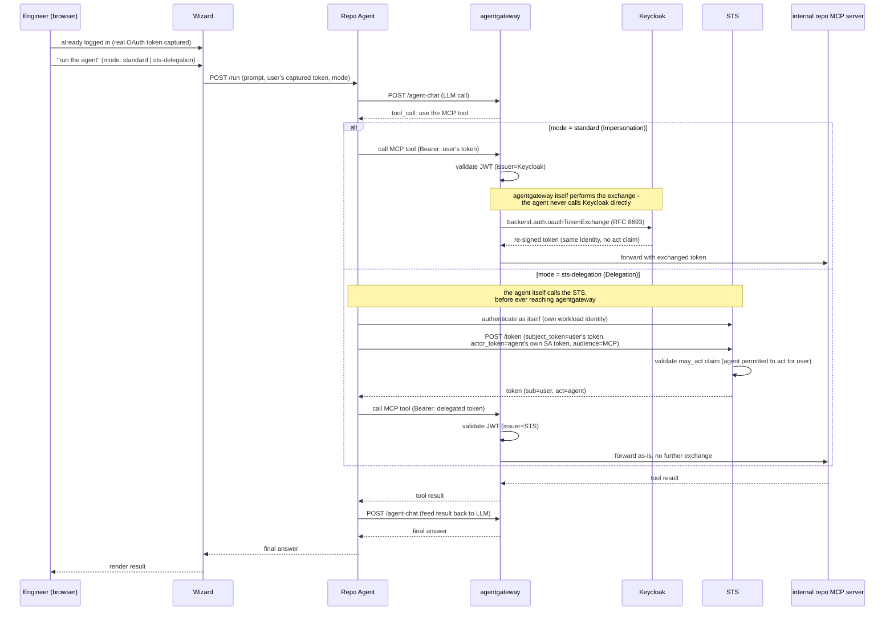
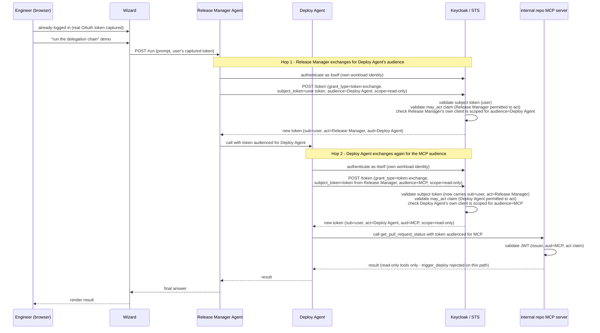
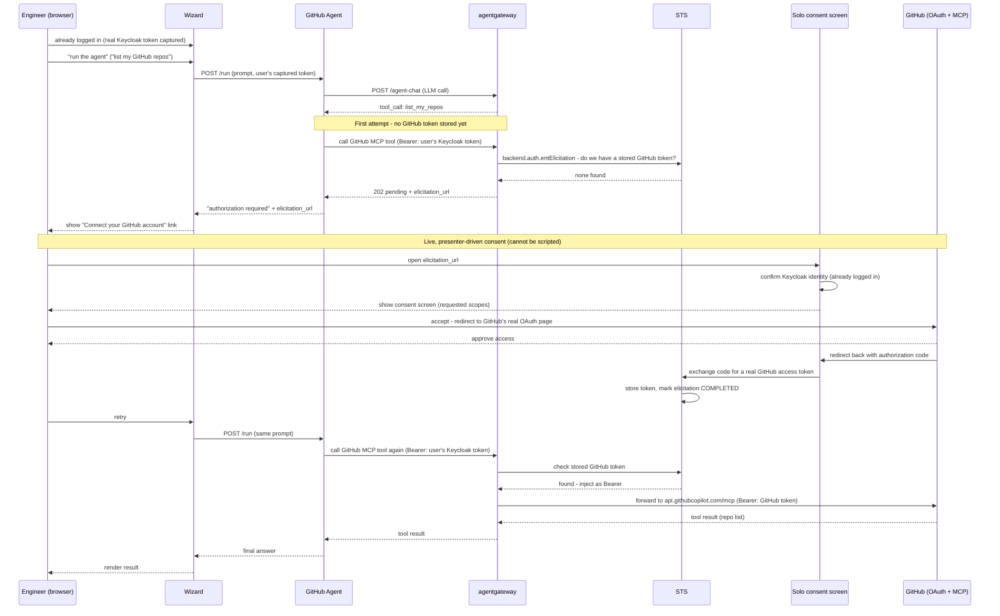

# Auth pillar: real agents and MCP servers for token exchange

## Problem

The "Who's allowed to do what" pillar's standard-exchange and STS-exchange steps demonstrate token exchange via raw HTTP requests driven by `DriveRequestPane` - the wizard's own backend performs the exchange and forwards the call. This proves the mechanism works, but it's not relatable to a demo audience: nothing in the demo looks like what an actual AI agent deployment looks like, and a step whose entire point is "the wizard, acting as a delegating agent" never actually involves anything resembling an agent.

Separately, the pillar has no demonstration of Elicitation (STS-managed third-party OAuth, used when an agent needs to act against an external API like GitHub on the user's behalf) at all.

## Scope

Add three new agent-driven demo moments to the auth pillar, each backed by real, deployed agent containers and MCP servers rather than raw HTTP presets:

1. **`user -> agent -> mcp`** (single hop): one agent, two modes - Standard/Impersonation and STS/Delegation - against an internal MCP server.
2. **`user -> agent -> agent -> mcp`** (two-hop chain): a genuine multi-hop Delegation chain with audience-restricted, per-hop token exchange.
3. **Elicitation**: a dedicated agent connecting to a real third-party service (GitHub) via live, presenter-driven OAuth consent.

**Out of scope:** replacing the existing `DriveRequestPane`-driven standard-exchange and STS-exchange presets entirely - those stay as-is for presenters who want the fast, raw-request version; the agent-driven demos are new steps alongside them, not replacements. Also out of scope: building a production-grade agent framework - these are the minimum real agent containers needed to make the token exchange mechanics visible end to end.

## Terminology (clarified during design)

Only **four** distinct mechanisms exist, not five - "Impersonation" and "Delegation" are semantics, not separate implementations:

| Mechanism | Status in this pillar | What it does |
|---|---|---|
| Standard exchange (proxy-native) | Already built (`auth-exchange-standard`) | Impersonation semantics, no STS, no `act` claim |
| STS exchange - Delegation mode | Already built (`auth-exchange-sts`) | `act` claim identifying the delegating agent |
| STS exchange - Impersonation mode | Not built, not planned | Same outcome as Standard via a heavier mechanism - redundant teaching point, deliberately skipped |
| Elicitation (STS-managed 3rd-party OAuth) | New in this spec | User interactively consents to a *real* third-party service; STS stores/injects that token afterward |

A hard constraint that shapes the whole design: **Standard and Delegation exchanges only ever produce Keycloak-issued tokens, valid against backends that trust our own Keycloak realm.** They cannot produce a credential GitHub (or any other real third party) would accept. Only Elicitation can reach a real external service, because it's the one mechanism that performs an actual OAuth dance against that service's own authorization server.

## Architecture

### New MCP server: internal "repo" server

A new, self-built MCP server (same shape as the existing stock/currency servers: simple, JWT-protected against our own Keycloak realm), exposing fake-but-relatable internal repo/deployment data:
- `list_repos` - read-only
- `get_pull_request_status` - read-only
- `trigger_deploy` - write; gated separately in RBAC from the two read-only tools

This server is the backend for both the single-hop and two-hop demos. It is explicitly **not** connected to real GitHub - it's our own internal stand-in, themed to match the Elicitation step's real-GitHub moment later in the same pillar.

### New agents (4 containers)

| Agent | Pattern | Backend | Narrative |
|---|---|---|---|
| **Repo Agent** | `user -> agent -> mcp`, 2 modes (`standard` / `sts-delegation`) | internal repo MCP server | "What's the status of our repos?" - same agent, mode switch changes which exchange mechanism it uses |
| **Release Manager Agent** (front-line) | `user -> agent -> agent -> mcp`, hop 1 | - | Can only ever get a token scoped to read-only operations |
| **Deploy Agent** (specialist) | `user -> agent -> agent -> mcp`, hop 2 | internal repo MCP server | Only this agent's own exchange can produce a token scoped for `trigger_deploy` |
| **GitHub Agent** | Elicitation only | real GitHub MCP (`api.githubcopilot.com/mcp`, field-kit's existing `remote-mcp-over-https` pattern) | "Now let's connect to *your actual* GitHub" - real consent flow |

All four reuse field-kit's existing `workload-agent`/`agent` feature pattern (real ADK-based containers, own image, own ServiceAccount, call an LLM via agentgateway's `/agent-chat` route, call MCP tools) - the same mechanism already proven by `fd-loan-rbac-jwt-propagation`, `workload-identity-chain`, and `agent-workload-identity`, not a new agent framework.

### Repository layout

All five new containers (four agents, one MCP server) are co-located in a single new monorepo, `github.com/day0ops/ops-agents`, rather than five separate repos:

```
ops-agents/
├── agents/
│   ├── repo-agent/
│   ├── release-manager-agent/
│   ├── deploy-agent/
│   └── github-agent/
├── mcp-servers/
│   └── repo-server/
└── README.md
```

Each subdirectory gets its own Dockerfile and is built/pushed as its own image (same registry as the rest of this project, `australia-southeast1-docker.pkg.dev/field-engineering-apac/kasunt/...`), named after its directory (e.g. `repo-agent:0.1.0`) - matching the naming convention field-kit already uses for `stock-agent`/`fd-agent`/`loan-agent`. A monorepo makes sense here specifically because these five services are small, share the same ADK agent pattern (for the four agents) or the same minimal MCP-server pattern (for the repo server), and are only ever deployed together for this one demo pillar - shared CI, no cross-repo versioning to coordinate.

### Real infrastructure now required

This finally requires standing up pieces that have been deferred throughout this pillar's earlier work:

- **STS + Postgres + Helm `tokenExchange.*` toggle** in `agentgateway-field-kit` - needed for the Delegation chain and for Elicitation.
- **A GitHub OAuth app registration** (client ID/secret) for Elicitation, following field-kit's existing `elicitation-oauth-flow.yaml` pattern exactly (same env vars: `GITHUB_ISSUER_CLIENT_ID`/`GITHUB_ISSUER_CLIENT_SECRET`). The implementation wires these as required environment variables with no hardcoded fallback, same as field-kit's own reference usecase - a real GitHub app is registered and the env vars populated later, outside this plan, before the Elicitation flow can be exercised live.
- **Keycloak client configuration for the two-hop chain**: each agent's own client needs a pre-configured, static set of allowed audiences (see "Audience-restricted delegation is not a dynamic policy" below) - this is realm configuration in field-kit, not application code.

## Flow 1: `user -> agent -> mcp` (Standard vs. Delegation)



The contrast this makes visible: in Standard/Impersonation, agentgateway performs the exchange transparently - the agent never knows it happened. In STS/Delegation, the agent itself explicitly calls the STS before ever reaching agentgateway, which is the architectural reason Delegation can prove "which agent acted" and Impersonation can't.

## Flow 2: `user -> agent -> agent -> mcp` (two-hop Delegation chain)



### Audience-restricted delegation is not a dynamic policy (important, confirmed during design)

Research into Solo's STS and Keycloak found **no dynamic, per-request "Agent A may only request audience=Agent B" policy enforcement** - `apiValidator` protects the Solo UI's own elicitation endpoints, not audience ACLs, and there's an open Keycloak GitHub issue (#53040) specifically about multi-hop delegation, meaning this is genuinely unsettled territory in the underlying product. What *is* real and enforced:

- **`may_act` claim validation** - Keycloak checks the actor identified in `may_act` matches the actor token's `sub`, rejecting the exchange otherwise. This validates that a given agent's identity is permitted to act at all.
- **Audience narrowing** - Keycloak's `audience` request parameter narrows a token to a specific target and rejects the request if the client isn't authorized for that audience.

So "the delegation policy" in this design is **static, pre-configured Keycloak client scope** - Release Manager Agent's client is only ever granted the ability to request `audience=Deploy Agent`, configured ahead of time in the realm, not a dynamic runtime decision. The design is built honestly around what's real: each hop performs its own separate RFC 8693 exchange (not a propagated token), and the resulting read/write RBAC split at the MCP server comes from checking whichever token actually arrives, same mechanism field-kit's own `fd-loan-rbac-jwt-propagation` already proves works.

This was also where the design process ruled out an alternative: having Deploy Agent *propagate* Release Manager's token unchanged (field-kit's proven `MCP_AUTH_MODE=propagate` pattern) instead of re-exchanging. Propagation is the more defensible pattern per RFC 8693 itself for *this specific property* (nested `act` claims are explicitly "informational only" per RFC 8693 §4.1 and must not drive access-control decisions - only the top-level actor may). The two-hop re-exchange design here intentionally still performs real, separate exchanges per hop (matching the user's explicit requirement to demonstrate genuine multi-hop exchange, not just propagation) while keeping the RBAC-relevant decision at each hop's own top-level actor, consistent with the RFC's guidance.

## Flow 3: Elicitation (real GitHub)



Nothing from the consent screen onward can be scripted or automated - this matches field-kit's own `elicitation-oauth-flow.yaml`, which only tests the "pending" state automatically and marks the actual consent completion `manual: true`. This is by design the strongest "wow" moment of the three flows, precisely because the GitHub login happening on screen is real, not simulated.

## Transition to "What gets through" (guardrails pillar)

Narrative hook for the pillar boundary: "No matter how sophisticated the identity chain - a human, a delegated agent, a two-hop chain of agents, or an agent holding a real third-party credential - every response still passes through the same content safety net." The GitHub Agent's real repo data (or the Deploy Agent's result) becomes guardrails' first example of masking PII in *real* agent output, rather than a canned chat response, directly continuing the "same control point, every pattern" theme this whole wizard is built around.

## Testing

Consistent with how this pillar has treated STS and Elicitation throughout: Go-level tests cover what's mechanical and scriptable (preset wiring, manifest rendering, token-exchange request construction) with the same conventions as the rest of this repo. The actual multi-hop exchange chain and the Elicitation consent flow are live/manual verification against a real deployment - not mockable, same as the STS exchange step already is.

## Risks / open items

- **This is a three-repo effort of real size.** `ops-agents` (new, source for all five containers), `agentgateway-field-kit` (STS/Postgres infra, Keycloak realm config, deployment manifests referencing the built images), and `agentgateway-demo-wizard` (this repo - new registry steps, new agent-triggering UI). Coordinating image builds/tags across the new monorepo and field-kit's deployment config is a real sequencing dependency for implementation planning.
- **STS + Postgres has been deferred through this entire pillar's development and must finally be stood up** for this feature to work at all (Delegation chain and Elicitation both need it).
- **The GitHub OAuth app is a placeholder until implementation is complete** - the code/config is built against the env var contract, but registration and populating real values happens afterward, before any live demo of the Elicitation flow specifically (the other two flows don't depend on it).
- **Keycloak client scope configuration for the two-hop chain is static, not dynamic** - this needs to be set up correctly per-agent-client ahead of time in field-kit's realm config, and is worth being explicit about in the demo narration so the audience doesn't walk away believing the STS enforces a general-purpose delegation graph it doesn't actually enforce.
- **The internal repo MCP server's data is entirely fake** - this needs to be clearly presented as "our own internal system," not conflated with the real GitHub data the Elicitation step surfaces later, since both are repo-themed.
