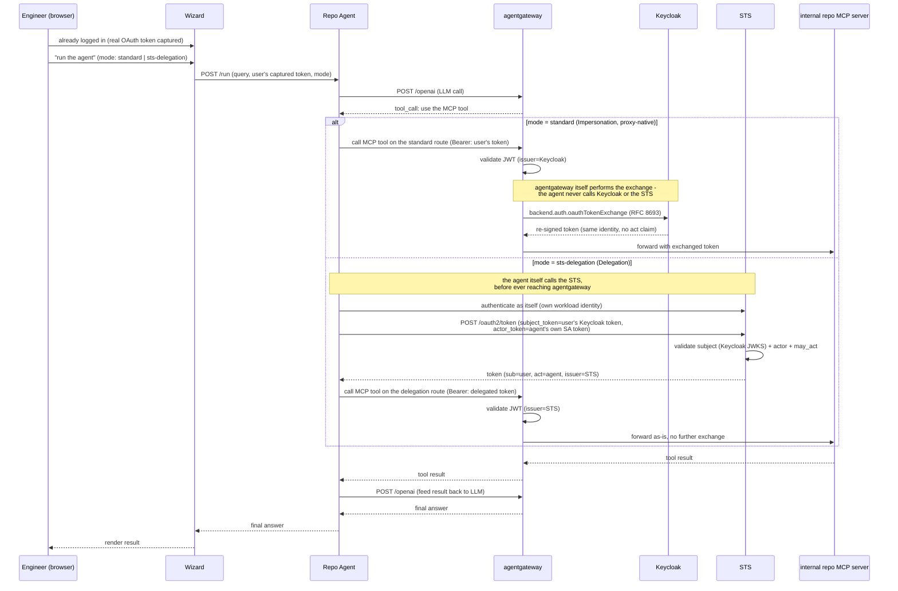
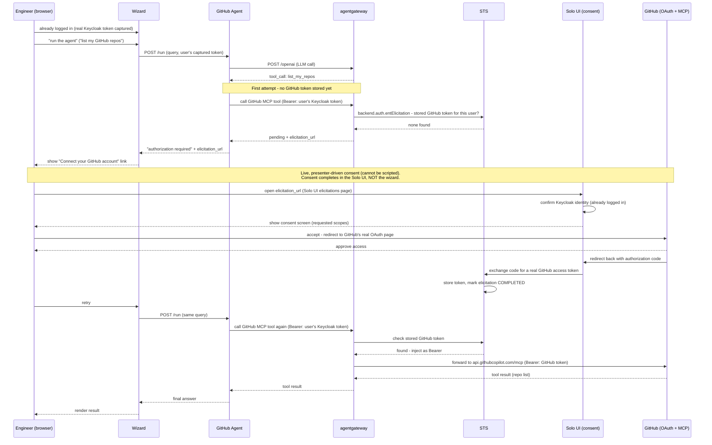

# Auth pillar: real agents and MCP servers for token exchange

## Problem

The "Who's allowed to do what" pillar's standard-exchange and STS-exchange steps demonstrate token exchange via raw HTTP requests driven by `DriveRequestPane` - the wizard's own backend performs the exchange and forwards the call. This proves the mechanism works, but it's not relatable to a demo audience: nothing in the demo looks like what an actual AI agent deployment looks like, and a step whose entire point is "the wizard, acting as a delegating agent" never actually involves anything resembling an agent.

Separately, the pillar has no demonstration of Elicitation (STS-managed third-party OAuth, used when an agent needs to act against an external API like GitHub on the user's behalf) at all.

## Scope

Add three new agent-driven demo moments to the auth pillar, each backed by real, deployed agent containers and MCP servers rather than raw HTTP presets:

1. **`user -> agent -> mcp`** (single hop): one agent, two modes - Standard/Impersonation (proxy-native) and Delegation (Solo STS) - against an internal MCP server.
2. **`user -> agent -> agent -> mcp`** (two-hop chain): a realistic multi-agent Delegation chain where each hop performs its own STS re-exchange, producing a nested `act` chain that records the full chain of custody (user -> front-line agent -> specialist agent) in a single token.
3. **Elicitation**: a dedicated agent connecting to a real third-party service (GitHub) via live, presenter-driven OAuth consent.

**Out of scope:** replacing the existing `DriveRequestPane`-driven standard-exchange and STS-exchange presets entirely - those stay as-is for presenters who want the fast, raw-request version; the agent-driven demos are new steps alongside them, not replacements. Also out of scope: building a production-grade agent framework - these are the minimum real agent containers needed to make the token exchange mechanics visible end to end.

## Terminology (clarified during design)

Only **four** distinct mechanisms exist, not five - "Impersonation" and "Delegation" are semantics, not separate implementations:

| Mechanism | Status in this pillar | What it does |
|---|---|---|
| Standard exchange (proxy-native) | Already built (`auth-exchange-standard`) | Impersonation semantics, no STS, no `act` claim. agentgateway itself exchanges the token at Keycloak via `backend.auth.oauthTokenExchange`. |
| STS exchange - Delegation mode | Already built (`auth-exchange-sts`) | `act` claim identifying the delegating agent. Solo's controller-side STS (issuer = `<STS host>:7777`). |
| STS exchange - Impersonation mode | Not built, not planned | Same outcome as Standard via a heavier mechanism - redundant teaching point, deliberately skipped |
| Elicitation (STS-managed 3rd-party OAuth) | New in this spec | User interactively consents to a *real* third-party service; STS stores/injects that token afterward |

Two design decisions set during review, which this spec is built around:
- **Impersonation always uses agentgateway's proxy-native standard exchange** (`backend.auth.oauthTokenExchange`), never the STS's own impersonation mode.
- **All delegation uses Solo's controller-side STS**, never Keycloak's own native token-exchange grant. (Keycloak-native exchange, with its `may_act`/audience-narrowing/per-client-scope model, is explicitly *not* used here - that model was researched and set aside.)

A hard constraint that shapes the whole design: **Standard and Delegation exchanges only ever produce tokens valid against backends that trust our own Keycloak realm or our own STS.** They cannot produce a credential GitHub (or any other real third party) would accept. Only Elicitation can reach a real external service, because it's the one mechanism that performs an actual OAuth dance against that service's own authorization server.

## Architecture

### New MCP server: internal "repo" server

A new, self-built MCP server (same shape as the existing stock/currency servers: simple, JWT-protected by agentgateway in front of it, with no auth logic of its own), exposing fake-but-relatable internal repo/deployment data:
- `list_repos` - read-only
- `get_pull_request_status` - read-only
- `trigger_deploy` - write; gated separately from the two read-only tools by a CEL authorization rule on the gateway route (see Flow 2)

This server is the backend for both the single-hop and two-hop demos. It is explicitly **not** connected to real GitHub - it's our own internal stand-in, themed to match the Elicitation step's real-GitHub moment later in the same pillar.

### New agents (4 containers)

| Agent | Pattern | Backend | Narrative |
|---|---|---|---|
| **Repo Agent** | `user -> agent -> mcp`, 2 modes (`standard` / `sts-delegation`) | internal repo MCP server | "What's the status of our repos?" - same agent, mode switch changes which exchange mechanism it uses |
| **Release Manager Agent** (front-line) | `user -> agent -> agent -> mcp`, hop 1 | - | Exchanges the user's token at the STS (`act=release-manager`), passes the delegated token to Deploy Agent. |
| **Deploy Agent** (specialist) | `user -> agent -> agent -> mcp`, hop 2 | internal repo MCP server | Re-exchanges the token it received at the STS, producing a nested `act` chain (`act=deploy-agent`, `act.act=release-manager`), then calls the MCP tool. The MCP route surfaces the full chain of custody. |
| **GitHub Agent** | Elicitation only | real GitHub MCP (`api.githubcopilot.com/mcp`, field-kit's existing `remote-mcp-over-https` pattern) | "Now let's connect to *your actual* GitHub" - real consent flow |

All four are real ADK-based containers following field-kit's existing `workload-agent`/`agent` feature pattern (own image, own ServiceAccount, call an LLM via agentgateway's `/openai` route, call MCP tools over StreamableHTTP) - the same mechanism already proven by `fd-loan-rbac-jwt-propagation`, `workload-identity-chain`, and `agent-workload-identity`, not a new agent framework. Each exposes `POST /run` (`{"query": "...", ...}`) and `GET /health`, matching field-kit's deployment contract (`POST /<agent>/run` through the gateway, `GET /health` for probes).

### Implementation stack (verified against current docs)

- **Agents: Google ADK (`google-adk` 2.11.0, Python 3.10+).** Confirmed API surface:
  - Custom OpenAI-compatible LLM endpoint: `from google.adk.models.lite_llm import LiteLlm` → `LiteLlm(model="openai/gpt-4o-mini", api_base=<agentgateway /openai route>)`.
  - MCP tools over HTTP with a **per-request** bearer token: `MCPToolset(connection_params=StreamableHTTPConnectionParams(url=...), header_provider=<callback>)`, where the callback is `async def(ctx: ReadonlyContext) -> dict[str,str]` reading the token from `ctx.state` and returning `{"Authorization": f"Bearer {token}"}`. This is a documented 2.11.0 feature - it is how the per-user token threads into each MCP call.
  - Serving: wrap `InMemoryRunner` in a FastAPI app. `runner.run_async(user_id=..., session_id=..., new_message=types.Content(...))` returns an `AsyncGenerator[Event]`; iterate and pick `event.is_final_response()` for the answer (it is NOT a single return value). Per-request token is placed in session state (`InMemorySessionService.create_session(...)`, async) before the run so `header_provider` can read it.
- **MCP server: official `mcp` SDK (2.3.x), `FastMCP`.** Tools declared with `@mcp.tool()` (schema inferred from type hints + docstring); served via `mcp.run(transport="streamable-http", host="0.0.0.0", port=8000)` (default path `/mcp`). Behind agentgateway, configure allowed hosts / disable strict host-origin protection as needed.

### Repository layout

All five new containers (four agents, one MCP server) are co-located in a single new monorepo, `github.com/day0ops/ops-agents` (already created), rather than five separate repos:

```
ops-agents/
├── agents/
│   ├── repo-agent/
│   ├── release-manager-agent/
│   ├── deploy-agent/
│   └── github-agent/
├── mcp-servers/
│   └── repo-server/
└── README.md
```

Each subdirectory gets its own Dockerfile and is built/pushed as its own image (same registry as the rest of this project, `australia-southeast1-docker.pkg.dev/field-engineering-apac/kasunt/...`), named after its directory (e.g. `repo-agent:0.1.0`) - matching the naming convention field-kit already uses for `stock-agent`/`fd-agent`/`loan-agent`. A monorepo makes sense here specifically because these five services are small, share the same ADK agent pattern (for the four agents) or the same minimal MCP-server pattern (for the repo server), and are only ever deployed together for this one demo pillar - shared CI, no cross-repo versioning to coordinate.

### Real infrastructure now required

This finally requires standing up pieces that have been deferred throughout this pillar's earlier work:

- **STS + Postgres + Helm `tokenExchange.*` toggle** in `agentgateway-field-kit` - needed for the Delegation single-hop, the Delegation chain, and Elicitation. The STS's `subjectValidator` trusts our Keycloak realm's JWKS (so the subject of every exchange is a Keycloak-issued token).
- **A GitHub OAuth app registration** (client ID/secret) for Elicitation, following field-kit's existing `elicitation-oauth-flow.yaml` pattern exactly (same env vars: `GITHUB_ISSUER_CLIENT_ID`/`GITHUB_ISSUER_CLIENT_SECRET`). The implementation wires these as required environment variables with no hardcoded fallback - a real GitHub app is registered and the env vars populated later, outside this plan, before the Elicitation flow can be exercised live.
- **MCP-route JWT validation + chain surfacing.** The internal repo MCP server itself has no auth logic; the gateway route validates the exchanged token (issuer = STS, for the delegation flows) per RFC 8693, authorizing on the top-level actor. For the chain-of-custody demo, the route forwards the token's claims (or the token itself, via `preserveToken`) to the repo server so a tool's response can surface the full `sub` + nested `act` chain - this reuses the claim-forwarding the existing MCP templates already do (e.g. the `x-gw-*` headers).

## Flow 1: `user -> agent -> mcp` (Standard vs. Delegation)

The Repo Agent runs in one of two modes. The two modes need **two different gateway routes to the same MCP server**, because the gateway does different work in each:

- **`standard` mode (Impersonation, proxy-native):** the agent presents the user's own Keycloak token; the gateway route carries `backend.auth.oauthTokenExchange` and performs the exchange itself at Keycloak before forwarding.
- **`sts-delegation` mode (Delegation):** the agent performs the STS exchange itself, then presents the already-exchanged token; the gateway route only validates it (issuer = STS) and forwards as-is.



The contrast this makes visible: in Standard/Impersonation, agentgateway performs the exchange transparently - the agent never knows it happened, and the exchanged token carries no `act` claim. In Delegation, the agent itself explicitly calls the STS before ever reaching agentgateway, and the result carries `act=agent`, which is the architectural reason Delegation can prove "which agent acted" and Impersonation can't.

## Flow 2: `user -> agent -> agent -> mcp` (two-hop Delegation chain, re-exchange)

Each hop performs its own STS exchange. The front-line agent exchanges the user's Keycloak token; the specialist agent re-exchanges the token it received. The result is a single token carrying a nested `act` chain - the full `user -> release-manager -> deploy-agent` chain of custody. This was confirmed to work on Solo's STS as-is (see the spike finding below).

```mermaid
sequenceDiagram
    participant User as Engineer (browser)
    participant Wizard
    participant AgentA as Release Manager Agent
    participant STS
    participant AgentB as Deploy Agent
    participant AGW as agentgateway
    participant MCP as internal repo MCP server

    User->>Wizard: already logged in (real OAuth token captured)
    User->>Wizard: "run the delegation chain" demo
    Wizard->>AgentA: POST /run (query, user's captured token)
    AgentA->>AGW: POST /openai (LLM call: decides to delegate to Deploy Agent)

    Note over AgentA,STS: Hop 1 exchange - at the front-line agent
    AgentA->>STS: POST /oauth2/token (subject_token=user's Keycloak token,<br/>actor_token=Release Manager's own SA token)
    STS->>STS: validate subject (Keycloak) + actor (k8s SA)
    STS-->>AgentA: T1 (sub=user, act=release-manager, issuer=STS)

    AgentA->>AgentB: POST /deploy-agent/run (query, Bearer: T1)
    AgentB->>AGW: POST /openai (LLM call: decides to call the MCP tool)

    Note over AgentB,STS: Hop 2 re-exchange - at the specialist agent
    AgentB->>STS: POST /oauth2/token (subject_token=T1 [STS-issued],<br/>actor_token=Deploy Agent's own SA token)
    STS->>STS: validate subject (self-issued) + actor (k8s SA)
    STS-->>AgentB: T2 (sub=user, act=deploy-agent,<br/>act.act=release-manager, issuer=STS)

    AgentB->>AGW: call MCP tool (Bearer: T2)
    AGW->>AGW: validate JWT (issuer=STS); authorize on top-level actor (deploy-agent)
    AGW->>MCP: forward T2 / its claims
    MCP->>MCP: surface the chain: user -> release-manager -> deploy-agent
    MCP-->>AGW: result (incl. the delegation chain that authorized it)
    AGW-->>AgentB: result
    AgentB-->>AgentA: result
    AgentA-->>Wizard: final answer
    Wizard-->>User: render result
```

**The chain-of-custody lesson:** the single token that finally reaches the MCP server carries the entire delegation history - `sub=user` (preserved end to end), `act=deploy-agent` (the current actor), and `act.act=release-manager` (the prior actor). The repo MCP server surfaces that chain in its response, so the audience sees that the action was performed by Deploy Agent, on behalf of Release Manager, on behalf of the real logged-in user - a complete, cryptographically-signed audit trail in one token, not scattered across logs. Per RFC 8693, agentgateway authorizes on the top-level actor (Deploy Agent); the nested prior actors are the audit record.

### Spike finding: re-exchange works on Solo's STS as-is (confirmed live)

Prior documentation research predicted this would NOT work - the STS's `subjectValidator` points only at Keycloak's JWKS, so an STS-issued token (different issuer) was expected to fail subject validation. A live spike against the running STS **disproved that**: a second exchange with an STS-issued token as `subject_token` returned 200, and the STS correctly produced an RFC 8693 nested `act` claim (`act = {sub: <hop-2 actor>, act: {sub: <hop-1 actor>}}`). So no STS reconfiguration is needed; the STS accepts its own self-issued tokens as exchange subjects in addition to Keycloak-issued ones.

Two honest caveats this design accepts:
- **Authorization is on the top-level actor, not the whole chain.** Per RFC 8693 §4.1, nested prior `act` claims are informational (audit), not an access-control input. So this flow's value is the *audit trail*, not a privilege cap - which is exactly the lesson chosen for it. (An enforced cap across the chain would require a custom CEL rule walking `act.act`; deliberately out of scope here.)
- **The STS does not enforce monotonic scope/audience narrowing** (confirmed by earlier research: it issues what's requested once subject + actor validate). So the chain's security value is the signed custody record, not scope attenuation.

## Flow 3: Elicitation (real GitHub)



Two things to call out:
- **Consent completes in the Solo UI, not the wizard.** The elicitation URL points at the Solo UI's own elicitations page (this matches field-kit's `elicitation-oauth-flow.yaml`). So mid-demo the presenter leaves the wizard, completes the GitHub consent in the Solo UI, and returns to the wizard to retry. This is a real UX seam worth scripting into the demo narration.
- **Nothing from the consent screen onward can be scripted or automated** - field-kit's own reference usecase only tests the "pending" state automatically and marks the consent completion `manual: true`. This is by design the strongest "wow" moment of the three flows, precisely because the GitHub login happening on screen is real.

## Transition to "What gets through" (guardrails pillar)

Narrative hook for the pillar boundary: "No matter how sophisticated the identity chain - a human, a delegated agent, a two-hop chain of agents, or an agent holding a real third-party credential - every response still passes through the same content safety net." The GitHub Agent's real repo data (or the Deploy Agent's result) becomes guardrails' first example of masking PII in *real* agent output, rather than a canned chat response, directly continuing the "same control point, every pattern" theme this whole wizard is built around.

## Testing

Consistent with how this pillar has treated STS and Elicitation throughout: Go-level tests cover what's mechanical and scriptable in this repo (preset wiring, manifest rendering, the registry's new steps) with the same conventions as the rest of the repo. The agent/MCP container code in `ops-agents` gets its own unit tests (tool handlers, the STS-exchange request construction, the FastAPI `/run` and `/health` handlers). The end-to-end flows - an agent actually driving an LLM and MCP tool call, the two-hop re-exchange chain, and especially the Elicitation consent flow - are live/manual verification against a real deployment, not mockable, same as the STS exchange step already is. (The two-hop re-exchange and its nested `act` output have already been proven once via the design spike.)

## Risks / open items

- **This is a three-repo effort of real size.** `ops-agents` (new, source for all five containers), `agentgateway-field-kit` (STS/Postgres infra, deployment manifests referencing the built images, MCP-route policies), and `agentgateway-demo-wizard` (this repo - new registry steps, new agent-triggering UI). Coordinating image builds/tags across the new monorepo and field-kit's deployment config is a real sequencing dependency for implementation planning.
- **STS + Postgres has been deferred through this entire pillar's development and must finally be stood up** for this feature to work at all (Delegation single-hop, Delegation chain, and Elicitation all need it).
- **The GitHub OAuth app is a placeholder until implementation is complete** - the code/config is built against the env var contract, but registration and populating real values happens afterward, before any live demo of the Elicitation flow specifically (the other flows don't depend on it).
- **ADK per-request MCP headers have a known memory-pressure caveat** (`adk-python` #5959: high-cardinality per-user tokens pool MCP sessions). Negligible at demo scale (two demo users), but worth noting so nobody is surprised.
- **The internal repo MCP server's data is entirely fake** - this needs to be clearly presented as "our own internal system," not conflated with the real GitHub data the Elicitation step surfaces later, since both are repo-themed.
- **Elicitation consent happens in the Solo UI, not the wizard** - the only one of the three flows where the presenter leaves the wizard mid-demo; must be scripted into the narration.
